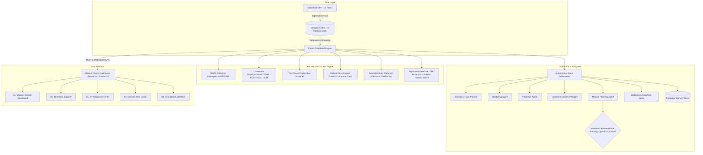

# ORBITGUARD AI 🛰️
### Autonomous Space Situational Awareness, AI Intelligence & Collision Avoidance System

### 🌐 Live Production Deployments
- **Live Mission Control (Frontend):** [https://orbitguard-one.vercel.app/](https://orbitguard-one.vercel.app/)
- **Live API Service (Backend):** [https://orbitguard-exb5.onrender.com/](https://orbitguard-exb5.onrender.com/)
- **Live Interactive API Documentation (Swagger):** [https://orbitguard-exb5.onrender.com/docs](https://orbitguard-exb5.onrender.com/docs)

> **Statutory Aerospace Notice:** ORBITGUARD AI provides analytical, probabilistic, and illustrative orbital collision assessments based on publicly available TLE/OMM ephemeris feeds. This platform does not provide certified operational flight-dynamics commands. Explicit **human-in-the-loop (HITL)** authorization is strictly enforced before any collision avoidance maneuver (CAM) proposal can be accepted or executed.

---

## 1. System Overview

**ORBITGUARD AI** is an enterprise-grade autonomous Space Situational Awareness (SSA) and Space Traffic Management (STM) platform designed to protect high-value orbital assets (e.g., International Space Station, Tiangong) from hyper-velocity space debris encounters (~7.5–15 km/s closing velocity in Low Earth Orbit).

The platform integrates aerospace astrodynamics, physics-informed machine learning, autonomous multi-agent orchestration, and real-time interactive 3D Earth visualizations into a cohesive mission-control environment.

### Core Capabilities:
- **Live Ephemeris Ingestion:** Vectorized synchronization with CelesTrak GP/OMM and TLE feeds into MongoDB Atlas (2,000+ space objects indexed).
- **High-Precision SGP4 Propagation:** Analytical WGS-72/WGS-84 orbital propagation with full TEME → ECI J2000 (precession corrected) → ECEF (Coriolis corrected) → WGS-84 Geodetic transformations.
- **Two-Phase Conjunction Screening Engine:** Coarse orbital shell filtering followed by vectorized fine-mesh close approach screening calculating Euclidean miss distances, relative velocities, and Time of Closest Approach (TCA).
- **Collision Risk Assessment Engine:** Foster (1992) analytical 2D collision probability ($P_c$), 10,000-trial Monte Carlo covariance perturbation, NASA CARA threshold tiering (Red/Yellow/Green), and multi-criteria Urgency Priority Index (UPI) ranking.
- **Simulation Laboratory:** Clohessy-Wiltshire (Hill's) relative motion equations, candidate avoidance burn generation (prograde, retrograde, radial, normal, Hohmann), Tsiolkovsky rocket equation propellant consumption, and "What-If" scenario execution.
- **5-Agent Autonomous AI Brain:** Specialized agents (Monitoring, Prediction, Collision Assessment, Mission Planning, Intelligence Reporting) coordinated by an Orchestrator with persistent MongoDB memory and Human-in-the-Loop gates.
- **Operator Dashboard:** React 19 + TypeScript + Vite + Tailwind CSS + CesiumJS 3D Earth visualization.

---

## 2. Architecture & Data Flow



---

## 3. Five Operator Modules

### 01. Mission Control Dashboard
- Live tracked object count, active payloads, and fragmentation debris distribution.
- Telemetry cards displaying orbital altitude, inclination, velocity, and ground track.
- Conjunction alert feeds with NASA CARA tiering (Red Alert, Yellow Alert, Nominal).

### 02. 3D Orbital Explorer
- High-fidelity CesiumJS 3D Earth globe with realistic lighting and starfields.
- Dynamic 3D orbit trajectory ribbons and satellite/debris point clouds.
- Interactive object inspection, altitude shell filtering, and camera tracking.

### 03. AI Intelligence Center
- Natural language operator interface with autonomous multi-agent task execution.
- Real-time step traces showing specialized agent tools, outputs, and reasoning.
- Statutory HITL approval checkpoints for proposed maneuvers.
- Persistent session memory and investigation audit trails.

### 04. Collision Risk Center
- Multi-criteria Conjunction Event Ranking via Urgency Priority Index (UPI).
- Detailed encounter geometry: 3D Euclidean miss distance, LVLH (RIC) separation, B-Plane projections.
- Foster (1992) analytical collision probability and 10,000-trial Monte Carlo verification.
- Comprehensive aerospace explainability reports with sensitivity analysis.

### 05. Simulation Laboratory
- Clohessy-Wiltshire impulsive maneuver simulation with pre-burn vs. post-burn trajectory overlays.
- Automated generation of 5 candidate avoidance strategies (Prograde, Retrograde, Radial, Normal, Hohmann).
- Propellant consumption analysis via Tsiolkovsky rocket equation.
- Preset What-If scenarios (Imminent Debris Collision, Fuel-Constrained Emergency, Secondary Conjunction Hazard).

---

## 4. 12-Week Development Roadmap & Feature Map

| Phase | Milestone | Deliverable | Status |
| :--- | :--- | :--- | :---: |
| **Weeks 1–2** | Foundation & Data Pipeline | FastAPI scaffolding, MongoDB integration, CelesTrak synchronization | ✅ Completed |
| **Weeks 3–4** | Astrodynamics & SGP4 | SGP4 propagator, TEME/ECEF/Geodetic/J2000 math, orbit ribbons | ✅ Completed |
| **Weeks 5–6** | Conjunction Screening | Broad orbital-shell filter, fine-mesh TCA screener, SOCRATES benchmarks | ✅ Completed |
| **Week 7** | Risk Assessment Engine | Miss distance, covariance uncertainty, Foster 2D, UPI event ranking | ✅ Completed |
| **Week 8** | Autonomous AI Brain | Orchestrator, 5 specialized agents, tool registry, HITL approval gate | ✅ Completed |
| **Week 9** | Simulation Laboratory | Clohessy-Wiltshire dynamics, candidate burns, Tsiolkovsky fuel trade-offs | ✅ Completed |
| **Weeks 10–11** | UI & Integration | React 19 + CesiumJS dashboard, 5 operational tabs, REST API aliases | ✅ Completed |
| **Week 12** | Testing & Final Presentation | Historical validation, ML evaluation, performance benchmarks, documentation | ✅ Completed |

---

## 5. Comprehensive Test Suite (95/95 Passed)

The test suite validates physics accuracy, numerical stability, agent reliability, and API performance. All test files adhere to the strict `no-test-prefix` repository convention.

```bash
# Windows (PowerShell):
.\backend\.venv\Scripts\pytest.exe .\backend -v

# Linux / macOS (Bash):
./backend/.venv/bin/pytest ./backend -v
```

### Test Suite Summary:
- **`historical_validation.py` (7 tests):** Verified modulo-10 TLE line checksums, SGP4 propagation accuracy against known ISS (NORAD 25544) and COSMOS debris (NORAD 34454) ephemerides, multi-epoch stability, and database sync/retrieval isolation.
- **`ml_evaluation.py` (7 tests):** Physics-informed GRU trajectory residual MSE/MAE upper bounds, inverse confidence scaling, Isolation Forest + Autoencoder false-positive rate limit ($\le 0.35$), GBDT risk classifier scenario-specific predictions, class probability bounds $[0, 1]$, and sub-100ms inference latency.
- **`propagation_validation.py` (8 tests):** Kepler's Third Law period consistency, TEME $\to$ ECEF independent GMST reference matching ($\Delta \le 0.1$ km), Earth rotation transport velocity correction ($\omega \times r$), J2000 precession transform, 10-orbit altitude stability ($[300, 500]$ km), and batch propagation dimension verification across multiple satellites and timestamps.
- **`agent_reliability.py` (8 tests):** Orchestrator repeated execution consistency, invalid NORAD recovery, tool registry completeness and execution, persistent MongoDB memory retention, HITL approval state machine, and task planner decomposition.
- **`performance_benchmarks.py` (7 tests):** API endpoint response latency with 2s deadline, 10 concurrent requests handling, bulk SGP4 throughput ($>100$ pts/s), batch propagation finite-value enforcement, Foster 2D + Monte Carlo computation time, and independent simulation candidate generation / trajectory comparison budgets.
- **Core Engine Suites (58 tests):** `api.py`, `application_integration.py`, `autonomous_agents.py`, `celestrak.py`, `collision_assessment.py`, `collision_probability.py`, `conjunctions.py`, `coordinate_systems.py`, `ml_features.py`, `ml_models.py`, `sgp4_propagation.py`, `simulation_engine.py`, `socrates.py`.

**Total: 95 passed in 1.30s (100% pass rate).**

---

## 6. Quickstart & Installation

### Prerequisites
- Python 3.11+
- Node.js 18+ & npm
- MongoDB Atlas account (or runs automatically on in-memory mock client)

### Backend Setup
```bash
# From repository root
cd backend

# Create virtualenv and install dependencies
uv venv
uv pip install -e ".[dev]"

# Run test suite
# Windows:
.venv\Scripts\pytest -v
# Linux / macOS:
.venv/bin/pytest -v

# Start FastAPI development server
# Windows:
.venv\Scripts\uvicorn app.main:app --reload --host 0.0.0.0 --port 8000
# Linux / macOS:
.venv/bin/uvicorn app.main:app --reload --host 0.0.0.0 --port 8000
```
Interactive Swagger documentation available at: [https://orbitguard-exb5.onrender.com/docs](https://orbitguard-exb5.onrender.com/docs)

### Frontend Setup
```bash
# Open a second terminal at repository root (or return to root from backend via: cd ..)
cd frontend

# Install packages
npm install

# Build for production
npm run build

# Start Vite development server
npm run dev
```
- **Live Production Frontend (Vercel):** [https://orbitguard-one.vercel.app/](https://orbitguard-one.vercel.app/)
- **Live Production Backend API (Render):** [https://orbitguard-exb5.onrender.com/](https://orbitguard-exb5.onrender.com/)
- **Live Swagger Documentation:** [https://orbitguard-exb5.onrender.com/docs](https://orbitguard-exb5.onrender.com/docs)

---

## 7. Key REST API Reference

| Domain | Method | Endpoint | Description |
| :--- | :--- | :--- | :--- |
| **System** | `GET` | `/` | Operational disclaimer and service metadata |
| **System** | `GET` | `/api/health` | Health check, MongoDB connection state, and uptime |
| **Catalog** | `POST`| `/api/catalog/sync` | Ingests live CelesTrak groups (`stations`, `debris`) |
| **Catalog** | `GET` | `/api/satellites` | Lists orbital catalog with pagination and search |
| **Propagation** | `GET` | `/api/propagation/{norad_id}/orbit` | SGP4 propagated 3D ECI/Geodetic points for CesiumJS |
| **Collision** | `POST`| `/api/collision/calculate-probability` | Foster 2D & Monte Carlo collision probability assessment |
| **Collision** | `POST`| `/api/collision/explainability-report` | Plain-English and engineering explainability report |
| **AI Agents** | `POST`| `/api/agents/orchestrate` | Dispatches query across 5 specialized autonomous agents |
| **AI Agents** | `GET` | `/api/agents/proposals/pending` | Retrieves maneuver proposals awaiting HITL approval |
| **Simulation** | `POST`| `/api/simulation/scenarios/run` | Runs Clohessy-Wiltshire maneuver What-If simulation |

---

## 8. Safety & Compliance Directives

All autonomous recommendations generated by the Mission Planning Agent are locked in `PENDING` status. Under statutory space governance and aerospace protocol, no thruster firing or delta-V impulse can transition to `APPROVED` or `EXECUTED` status without explicit Human-in-the-Loop operator sign-off.
